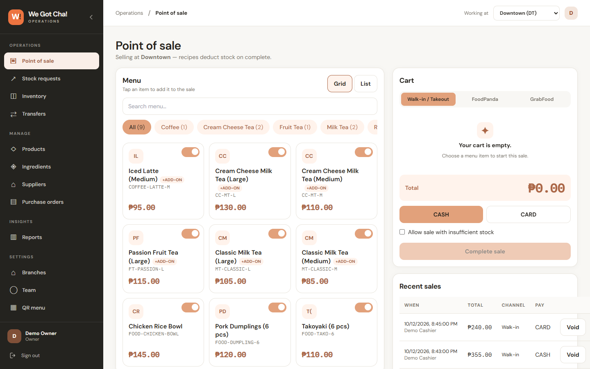
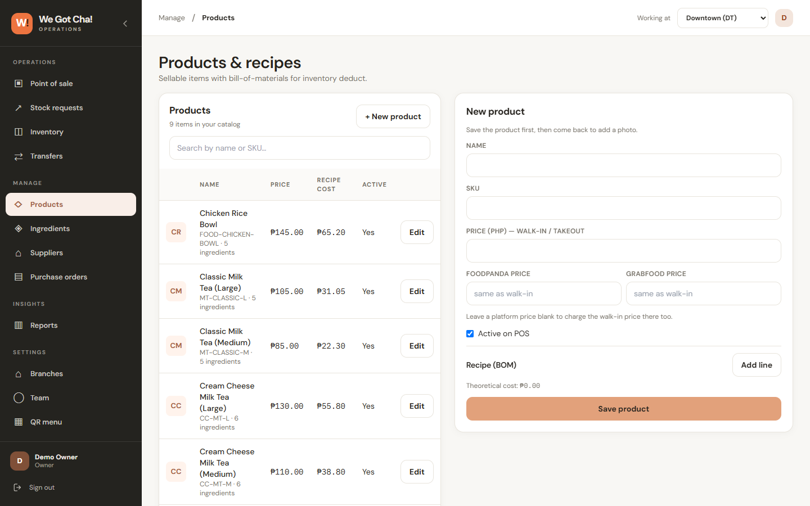
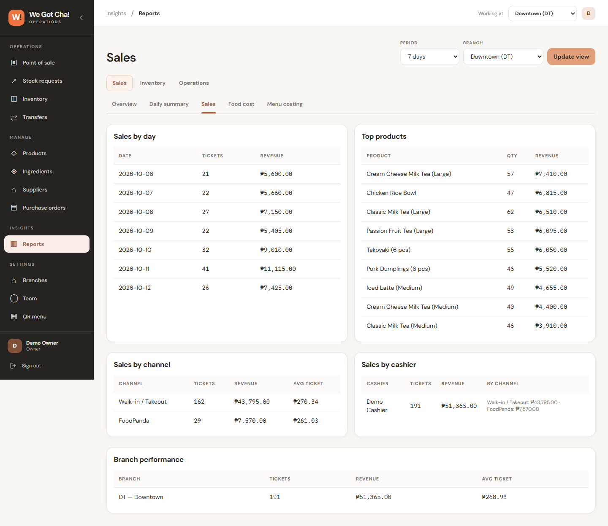
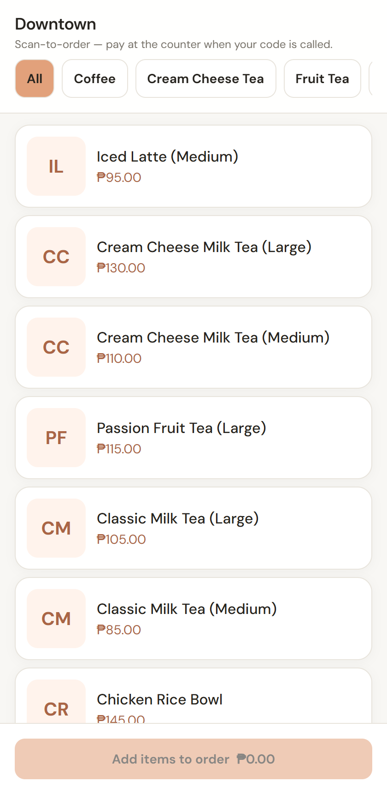

# Restoflow

A multi-branch restaurant POS and inventory system, built for a small restaurant group (We Got Cha!) by its owner. It tracks sales, recipe-based stock deduction, transfers between branches and a warehouse, purchasing, and reports.

**Status:** in development. A production pilot at one branch is planned. This public copy contains only synthetic demo data. The production system, with the real catalog, recipes, and prices, is in a private repository.

**Stack:** Next.js 15 (App Router), TypeScript, Tailwind, PostgreSQL with Prisma, Auth.js, Vitest, Docker, n8n for alerts.

## Screenshots

All screenshots use the synthetic demo data from `npm run db:seed`.

| Point of sale | Products and recipes |
|---|---|
|  |  |

| Sales report | QR ordering (phone) |
|---|---|
|  |  |

More in [docs/screenshots](docs/screenshots): login, inventory, transfers, menu costing, recipe health, daily summary, and purchasing.

## Why it exists

Branches kept stock on paper and in spreadsheets, so it was hard to see what was actually used, wasted, or missing. Restoflow ties every sale to a recipe, so ingredient use is tracked automatically and compared against physical counts.

## What it does

- **POS:** cart, cash/card/delivery-platform payment, stock deducted from the recipe, voids that reverse stock.
- **Recipes:** versioned. Editing a recipe creates a new version, and each sale records which version it used, so old reports stay correct.
- **Inventory:** on-hand levels, low-stock alerts, receiving, adjustments, waste, cycle counts.
- **Transfers:** branch to branch and warehouse to branch, staged as draft, in transit, received. Stock moves only on ship and receive.
- **Purchasing:** suppliers and purchase orders, with receiving that posts stock.
- **Reports:** sales, stock movement ledger, ingredient consumption, actual-vs-theoretical variance, waste, food cost.
- **Access control:** owner, manager, and cashier roles scoped by branch. Deactivating a user ends their sessions.
- **QR ordering:** customers order from a QR code, and a cashier claims the order into the POS. Retries cannot create duplicate sales.
- **Automation:** n8n workflows for inventory alerts, replenishment drafts, and a daily Telegram digest. See [docs/n8n-pilot.md](docs/n8n-pilot.md).

## Engineering notes

- All stock changes go through one function (`applyMovement` in `src/lib/stock.ts`), which writes to an append-only ledger and takes a per-branch, per-ingredient advisory lock.
- Money is stored as integer cents. Quantities use Prisma `Decimal`.
- A warehouse is a branch with `type: WAREHOUSE`. It holds stock and can send and receive transfers, but it does not sell.
- Tests create their own organization per test, so the suite can run against a shared database without wiping other data.

## Run it locally

Requires Node 20+ and Docker.

```bash
cp .env.example .env
npm install
docker compose up -d
npx prisma migrate deploy
npm run db:seed     # synthetic demo data
npm run dev
```

Open http://localhost:3000. Demo logins (all use the password `password123`, for local demo only):

| Email | Role |
|-------|------|
| `owner@demo.local` | Owner (all branches) |
| `manager@demo.local` | Manager |
| `cashier@demo.local` | Cashier |

The seed creates 3 stores and a warehouse, 23 ingredients, 9 products with recipes, add-on and sweetness options, stock levels (a few set low on purpose), and 21 days of invented sales.

## Scripts

| Command | Purpose |
|---------|---------|
| `npm run dev` | Dev server |
| `npm run build` | Production build |
| `npm run typecheck` | TypeScript check |
| `npm run lint` | ESLint |
| `npm test` | Vitest suite (needs `DATABASE_URL` pointing at a Postgres) |
| `npm run db:seed` | Wipe and reseed the demo database |

## More

Architecture, decisions, and known issues are in [docs/](docs/index.md).
